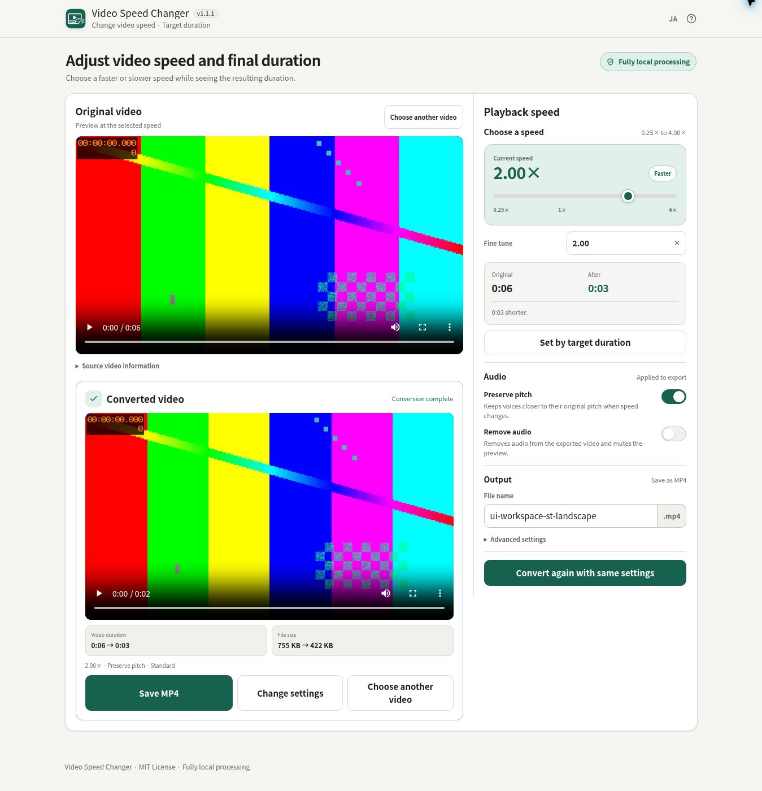

# Video Speed Changer

[](https://github.com/ttomohisa/htmlapps-video-speed-changer/actions/workflows/deploy-pages.yml)
[](LICENSE)

[日本語版 README](README.ja.md)

Change a video's speed from 0.25× to 4.00×, check its resulting duration, and save an MP4 entirely in your browser. Version 1.1.1 provides separate single-thread (ST) and multi-thread (MT) builds.

[Open the standard ST app](https://ttomohisa.github.io/htmlapps-video-speed-changer/) · [Open the hosted MT app](https://ttomohisa.github.io/htmlapps-video-speed-changer/mt/)

[](https://ttomohisa.github.io/htmlapps-video-speed-changer/)

## Features

- Set a speed with the slider or a precise number, and see the resulting duration immediately.
- Calculate speed from a target duration. The whole-second range is shown; opening the panel does not change your speed.
- Preview the original at the selected speed, then review the clearly labeled converted video and save it. On desktop the result appears below the source, keeping settings compact. Previews fit the video without cropping, including portrait sources.
- Preserve pitch, shift pitch with speed, or remove audio.
- Choose High quality, Standard, or Smaller file, and edit the output filename.
- Cancel an active conversion. Cancelling or failing a reconversion keeps the previous result and its matching automatic filename; your edited filename is preserved.
- Japanese and English UI, local processing, and embedded FFmpeg JS/WASM and Worker assets.

## How to use

1. Open the ST app, or use MT on a compatible isolated host.
2. Choose or drop one video.
3. Set speed from 0.25× to 4.00×. Alternatively, open **Set by target duration**, check the available range, and deliberately edit the desired time. The initial value is only a rounded suggestion.
4. Choose audio behavior and, if needed, output quality in **Advanced settings**.
5. Check the filename, then choose **Convert with these settings** directly below the speed/target-duration controls. Progress and cancellation appear in the same place.
6. Preview the result, compare duration/file size, and choose **Save MP4**.

If native video preview fails, embedded FFmpeg can inspect some files and allow conversion without a native preview. Support for every codec or damaged file is not guaranteed.

**Cancel conversion** stops the active Worker and retains the current source/settings. An older result remains saveable until a replacement conversion succeeds or you select another source. Switching to another app URL does not automatically transfer your selected video or result.

## Privacy and local processing

Selected videos are never uploaded. FFmpeg, WASM and pthread Worker code are embedded in each build. There is no runtime CDN, analytics, telemetry, remote font, API or automatic update request; CSP keeps `connect-src 'none'`.

Hosted pages require the initial HTML request. The GitHub Pages MT wrapper can additionally load the pinned same-origin `./coi-serviceworker.js`, register it within `/mt/`, and reload to establish isolation. This helper supplies response headers, does not upload video, and is not an offline application cache. Hosts already providing isolation headers do not load the fallback script. Raw standalone files contain no helper reference.

Build-time downloads from the pinned Builder release are separate from application runtime traffic.

## Browsers and devices

Current Chrome and Edge are the primary targets. Conversion uses WebAssembly, Workers, Blob URLs and `DecompressionStream`; native preview depends on browser codec support. Safari and Firefox capabilities and memory limits may differ.

MT additionally requires a secure hosted context with `crossOriginIsolated === true` and `SharedArrayBuffer` available. If unavailable, the app explains the limitation and blocks conversion and FFmpeg inspection. The standard ST app remains available; there is no hidden runtime download or silent ST fallback.

MT uses a pool of 8 pthread Workers, 2 video decoder threads, 4 H.264 encoder threads and 1 x264 lookahead thread. Audio codecs and filtergraphs remain single-threaded. Performance depends on the video, device and browser; MT is not always faster and can use more memory.

## Limitations

- Output is H.264/AAC MP4 from the dedicated speed-changing profile.
- Trimming, cropping, subtitles, transitions and speed ramps are not included.
- Very large, long or high-resolution videos can exceed device/browser memory.
- Native speed preview and encoded output can differ slightly, especially with pitch preservation.
- MT does not run directly from `file://`, and needs isolation headers or the hosted Pages fallback.

## Single-HTML and offline use

- ST: `video-speed-changer.html` / `dist/index.html`, and `dist/index.self-extract.html`. Open directly with `file://`, including when disconnected after obtaining the files.
- MT: `video-speed-changer.mt.html` / `dist/index.mt.html`, and `dist/index.mt.self-extract.html`. Each embeds its processing assets, but must be served from an isolated HTTP(S) context. A raw MT file cannot supply its own response headers.
- The self-extract variants use an embedded gzip payload and restore the corresponding readable HTML byte-for-byte.

For isolated hosting, GitHub Pages, Cloudflare previews and Browser Kitty integration instructions, see [Multi-thread deployment](docs/MULTI_THREAD_DEPLOYMENT.md). Follow [offline verification](VERIFY_OFFLINE.md) before publishing a release.

## Development and build

On Windows, run `build-standalone.bat`. Normal builds need PowerShell; Node.js 24 is required for the complete repository regression gate:

```powershell
./scripts/check-repository.ps1
```

Both variants use FFmpeg WASM Builder **v1.10.6**, profile `video-speed-changer`, pinned by `ffmpeg.release.json` and `ffmpeg.release.lock.json`. Normal builds verify the exact release asset byte count/SHA-256 and both runtime variants before embedding them. They refresh both root download files. Custom output builds leave those checked-in downloads unchanged.

```text
src/index.template.html               Editable app source
ffmpeg.release.json / .lock.json       Exact Builder release and verified pin
build-standalone.ps1 / .bat            Build both ST and MT
scripts/check-repository.ps1          Canonical build, artifact and regression gate
scripts/prepare-pages.ps1             Stage pages-dist without modifying raw releases
dist/index[.mt].html                  Raw readable ST / MT
dist/index[.mt].self-extract.html      Raw self-extract ST / MT
dist/dependency-manifest[.mt].json     Separate runtime/provenance manifests
dist/self-extract-manifest[.mt].json   Separate restoration manifests
dist/build-size-report[.mt].json       Separate size reports
pages-dist/index.html                 Raw ST hosted entry
pages-dist/mt/index.html               Hosted MT wrapper
pages-dist/mt/index.mt.html            Unmodified raw MT
```

To intentionally upgrade Builder, update `ffmpeg.release.json`, run `pin-ffmpeg-release.bat`, review release metadata/digests and profile smoke tests, then commit the validated lock and rebuild. Never use `latest` or hand-edit a hash to bypass verification. `build-with-local-ffmpeg.bat <builder-root>` is a Builder-development path only; its `local-builder` provenance is rejected for stable release artifacts.

Build validation, GitHub Pages and Cloudflare PR previews all run the canonical repository check on Node 24. Pages deploys `pages-dist/`; Cloudflare adds isolation only to `/mt/*` and checks the exact MT URL in Chromium. Preview deployment requires the existing Cloudflare secrets. Cleanup remains a separate PR-close workflow. To enable Pages, select **Settings → Pages → Source → GitHub Actions**.

The Node lifecycle tests execute the actual app script with synthetic DOM/media/runtime boundaries. They cover cancellation, source/result ownership, stale results and target-duration rules across release variants. Deployment tests execute the real staging script and CDP verifier with controlled fixtures. These do not replace real-video, browser/device or network checks; see [REGRESSION.md](REGRESSION.md).

## License and dependencies

Application source: [MIT](LICENSE). Embedded FFmpeg/x264 ST and MT binaries: GPL-2.0-or-later, with corresponding Builder v1.10.6 source obligations. Hosted Pages helper: coi-serviceworker 0.1.7, MIT, pinned by commit and SHA-256. See [THIRD_PARTY_NOTICES.md](THIRD_PARTY_NOTICES.md).

Copyright © 2026 ttomohisa. Contributions and bug reports are welcome; see [CONTRIBUTING.md](CONTRIBUTING.md).


Work stays in this tab. Save MP4 downloads the displayed converted result; Download started acknowledges browser handoff. A previous result remains available when reconversion fails or stops.
